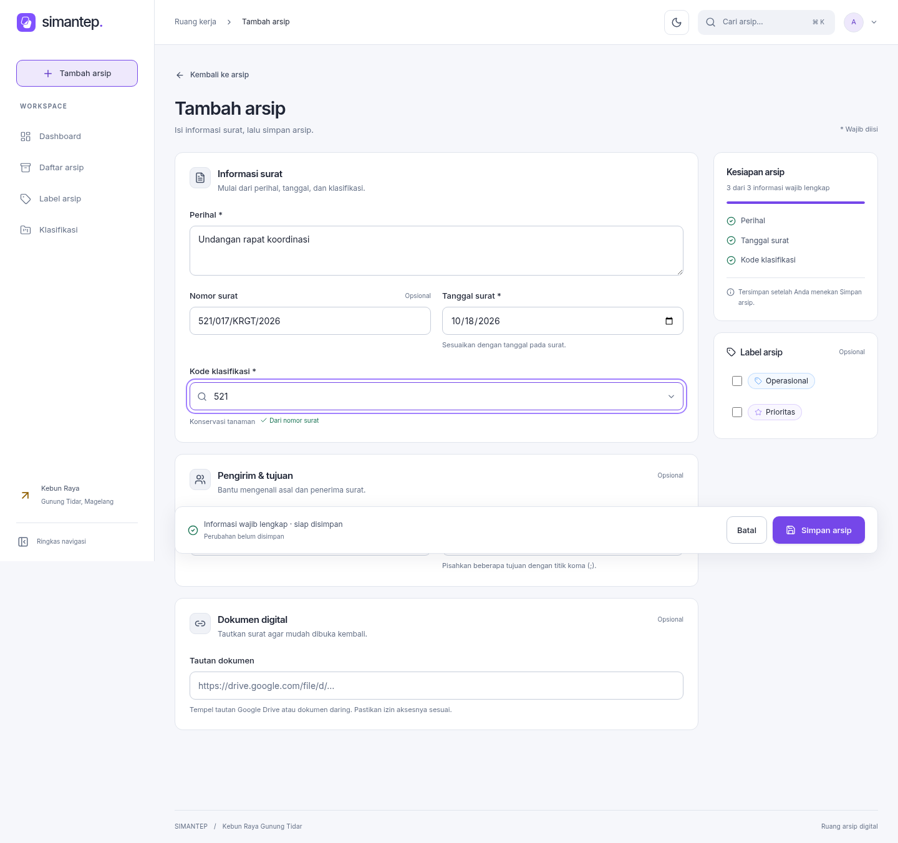

# SIMANTEP KRGT — acuan desain

Status: implementasi antarmuka per 18 Oktober 2026. Baca bersama
[panduan pengembangan](docs/pengembangan.md) dan [audit form](docs/audit-form-arsip.md).

## Arah produk

SIMANTEP membantu petugas menemukan surat, mencatat arsip, memeriksa retensi,
dan meninjau kondisi koleksi. Desain mengutamakan pencarian, keterbacaan data,
serta kejelasan hasil tindakan. Fitur inti, database, dan optimasi query yang
sudah ada tetap dipertahankan.

Mode terang adalah bawaan. Pilihan mode gelap disimpan di perangkat. Gunakan
aksen violet untuk tindakan utama, permukaan netral, garis pemisah halus, dan
ruang yang cukup tanpa membuat data utama jauh dari jangkauan.

[DESIGN asli dari pengguna](docs/referensi/DESIGN-original.md) disimpan tanpa
perubahan sebagai referensi visual historis. Arahan berikutnya dari pengguna
(light default, dashboard profesional, alur kerja sederhana) menjadi dasar
desain saat ini. Ukuran judul dan latar hitam pada referensi pemasaran tersebut
bukan spesifikasi wajib untuk layar kerja arsip.

## Token dan tipografi

Sumber warna semantik: `sistem-arsip/src/styles/theme.css`.
Font dan token Tailwind: `sistem-arsip/src/styles/index.css`.

| Token | Light | Dark | Penggunaan |
| --- | --- | --- | --- |
| `--canvas` | `#f6f7fb` | `#10131b` | Latar aplikasi |
| `--surface` | `#ffffff` | `#171c26` | Panel dan form |
| `--surface-muted` | `#f0f2f7` | `#202735` | Bagian sekunder |
| `--text-primary` | `#202636` | `#eff2f8` | Judul dan nilai utama |
| `--text-secondary` | `#465167` | `#bcc5d6` | Teks pendukung |
| `--text-muted` | `#647086` | `#99a6bc` | Petunjuk dan metadata |
| `--accent` | `#7547e9` | `#8052ff` | Tombol utama dan indikator |
| `--accent-text` | `#6740c8` | `#c0aaff` | Tautan dan aksi teks |
| `--line` | `#e1e5ed` | `#2d3544` | Batas panel |
| `--danger` | `#bd3344` | `#ff99a6` | Kesalahan |
| `--warning` | `#916000` | `#f3c463` | Kondisi perlu perhatian |
| `--success` | `#197454` | `#7bd9af` | Hasil berhasil |

Inter dibundel lokal melalui `@fontsource/inter`. Teks dasar 14 px dengan line
height 1,55. Judul form 29 px desktop dan 26 px ponsel; label 12–13 px. Input
ponsel 16 px untuk mengurangi pembesaran otomatis saat mengetik. Kode memakai
font monospace bila membantu pemindaian. Jangan menggunakan huruf kecil untuk
informasi yang diperlukan mengambil keputusan.

## Kerangka dan layar utama

- Sidebar tetap pada lebar 1.024 px ke atas; drawer navigasi pada layar kecil.
- Header menyediakan pencarian cepat dan pengalih tema. Pencarian daftar dan
  filter tetap tersimpan di URL sehingga dapat di-refresh dan dibagikan.
- Login menggunakan foto aset KRGT yang tersedia, satu tugas utama, label
  langsung, status sedang masuk, dan pesan kegagalan yang dapat ditindaklanjuti.
- Dashboard manajemen memiliki filter tahun/bulan, ringkasan, distribusi,
  cakupan dokumen digital, dan tabel laporan. Semua bagian mengikuti periode
  yang sama. Klik rincian mempertahankan konteks laporan saat kembali.
- Daftar arsip mengutamakan pencarian dan pemindaian baris. Detail, edit,
  impor/ekspor, klasifikasi, label, dan aturan retensi tetap tersedia.

Jangan menampilkan angka contoh sebagai data produksi, tren tanpa pembanding
yang sah, atau persentase pertumbuhan buatan saat nilai pembanding nol.
Bedakan tanggal surat dari waktu pencatatan. Lihat definisi perhitungan di
`src/app/dashboardData.js` dan pengujian statistiknya sebelum menambah metrik.

## Form tambah dan edit arsip

Form satu halaman dengan urutan kerja:

1. Informasi surat: perihal, nomor, tanggal, klasifikasi.
2. Pengirim dan tujuan; keduanya opsional.
3. Tautan dokumen; opsional, menerima URL HTTP/HTTPS yang valid.
4. Label opsional dan tombol simpan yang selalu mudah dijangkau.

Kolom wajib tetap tiga: perihal, tanggal surat, dan kode klasifikasi.
Nomor surat tetap opsional sesuai perilaku aplikasi. Jangan menjadikan field
opsional wajib hanya untuk menaikkan indikator kelengkapan.

Lebar maksimal form 1.140 px. Panel utama dan aside memakai dua kolom di layar
besar; di bawah 900 px menjadi satu alur. Di bawah 600 px, field satu kolom dan
indikator kelengkapan dipadatkan ke bar simpan. Pilihan label satu kolom di
bawah 400 px. Panel beradius 13 px, input 9 px; tinggi input minimal 45 px.

Klasifikasi dapat dicari melalui kode atau deskripsi. Prefiks nomor surat
mengisi kode otomatis sampai pengguna memilih kode manual. Pilihan manual
tidak ditimpa; sediakan aksi eksplisit untuk memakai saran lagi. Combobox
mendukung panah, Enter, Escape, klik, dan sentuhan; maksimal 50 opsi ditampilkan
sekaligus dengan petunjuk mempersempit pencarian.

## Umpan balik dan copywriting

| Keadaan | Respons antarmuka |
| --- | --- |
| Metadata klasifikasi dimuat | Isian teks tetap aktif; pilihan kode dan simpan menunggu metadata wajib |
| Label gagal dimuat | Pesan lokal dan coba lagi; tidak menghalangi penyimpanan arsip |
| Field tidak valid | Pesan dekat field; setelah submit ada ringkasan yang menautkan fokus ke field |
| Siap disimpan | “Informasi wajib lengkap · siap disimpan”; bukan klaim sudah tersimpan |
| Sedang menyimpan | Tindakan ganda dicegah, input dikunci sementara, status diumumkan |
| Berhasil | Toast singkat dan kembali ke konteks asal |
| Gagal | Isian dipertahankan; pesan menjelaskan langkah berikutnya; detail teknis dapat dibuka |
| Arsip berhasil, label gagal | Jelaskan hasil parsial; ulangi dengan ID yang sama agar tidak membuat arsip ganda |
| Meninggalkan perubahan | Dialog “Lanjut mengisi” atau “Keluar tanpa menyimpan”; memulihkan nilai semula menghapus peringatan |

Gunakan bahasa Indonesia sederhana: “Tambah arsip”, “Simpan arsip”, “Coba lagi”.
Hindari paragraf pengantar berulang, istilah teknis database dalam alur normal,
dan toast untuk setiap ketikan. Umpan balik tautan hanya menyatakan format
valid; tidak menjanjikan dokumen dapat diakses atau izin berbagi sudah benar.
Form tidak memiliki autosave atau pemulihan draft setelah tab ditutup.

## Aksesibilitas dan verifikasi desain

Gunakan label nyata, `aria-invalid`, petunjuk/error yang terhubung ke field,
fokus terlihat, dan teks selain warna untuk menyampaikan status. Pesan simpan
memakai status/alert yang sesuai. Fokus kesalahan diarahkan ke field pertama
atau banner kegagalan. Hormati preferensi reduced motion.

Periksa light/dark, keyboard, sentuhan, koneksi lambat, data kosong, gagal
simpan, dan gagal parsial. Regresi form tersedia di
`sistem-arsip/tests/e2e/archive-form.spec.js`; screenshot light/dark pada 320 dan
1.440 px dibuat oleh tes tersebut. Hasil tes adalah bukti perilaku pada skenario
yang diuji, bukan klaim audit aksesibilitas menyeluruh.

## Pratinjau form

Screenshot berikut memakai data fixture pengujian, bukan data produksi.
Bar simpan menempel di bagian bawah viewport; pada screenshot seluruh halaman
posisinya mengikuti viewport saat gambar diambil.

[Pratinjau ponsel dalam mode gelap](docs/images/form-arsip-mobile-dark.png).
